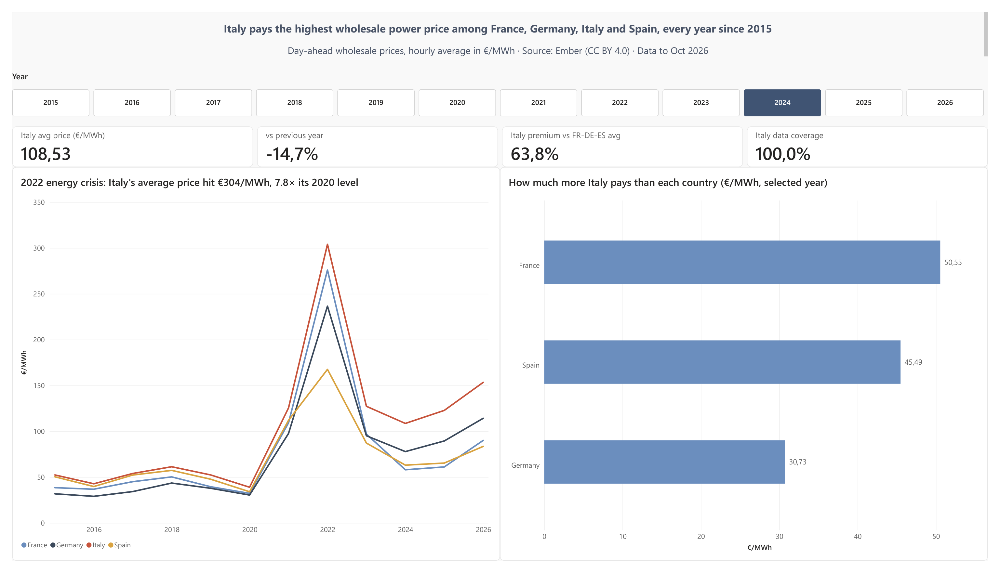
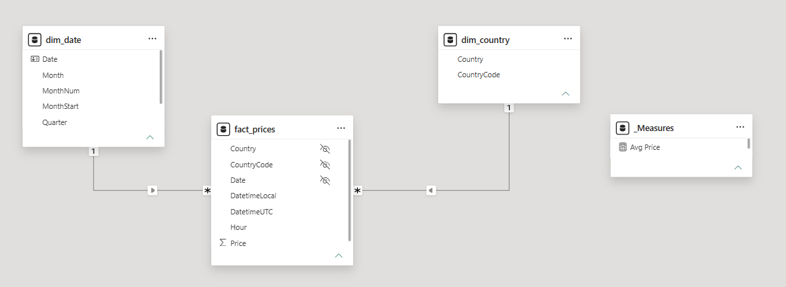
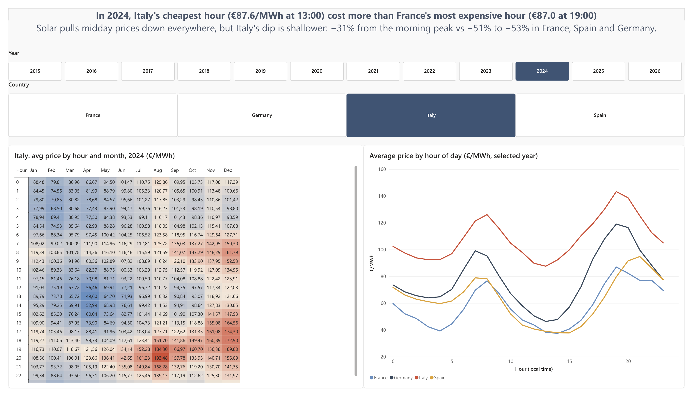
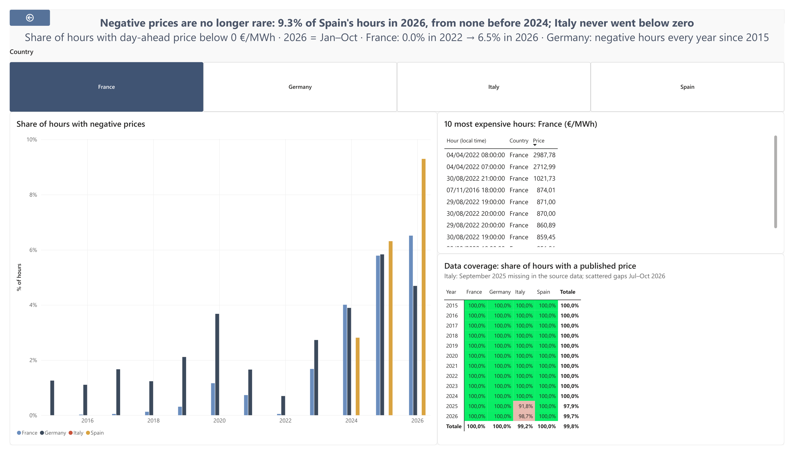

# European Wholesale Electricity Prices — Power BI Dashboard

**Italy vs France, Germany and Spain · hourly day-ahead prices · January 2015 – October 2026**

A Power BI report that compares day-ahead wholesale electricity prices in France, Germany, Italy and Spain, built end to end: data cleaning in Power Query, a star-schema model, DAX measures (time intelligence, ranking, data coverage) and a three-page report.



---

## Business questions

1. **Level and trend** — How expensive is wholesale electricity in Italy, year by year, and how much did it change versus the previous year?
2. **European comparison** — How much more does Italy pay than France, Germany and Spain, and is the gap widening or narrowing?
3. **Shape of the day** — In which hours and months is electricity cheapest or most expensive, and how deep is the midday "solar dip" in each country?
4. **Extreme events** — How often are prices negative, and when did the most expensive hours occur?

---

## Data

| | |
|---|---|
| **Source** | [Ember — European Wholesale Electricity Price Data](https://ember-energy.org/data/european-wholesale-electricity-price-data) (hourly file), day-ahead prices sourced by Ember from ENTSO-E and cleaned |
| **Licence** | [CC BY 4.0](https://creativecommons.org/licenses/by/4.0/) — Data: Ember |
| **Downloaded** | 11 November 2026 |
| **Scope** | France, Germany, Italy, Spain · 1 Jan 2015 – 31 Oct 2026 (local time) |
| **Size in model** | 414,079 hourly rows (country × hour) |

The raw CSV (~170 MB, all European countries) is **not** included in this repository because it exceeds GitHub's file size limit. See [How to reproduce](#how-to-reproduce).

---

## Data preparation (Power Query)

- **Locale fix.** The CSV uses a dot as decimal separator. With Power BI set to Italian, automatic type detection read `47.72` as `4772`. I removed the automatic "Changed type" step and set types explicitly **with the en-US locale**, so the query gives the same result on any machine.
- **Filtering.** Kept only the four countries before any other step, and cut the series at the last complete month (October 2026, local time).
- **New columns.** `Date` (local date, key to the calendar) and `Hour` (0–23, local time) from `DatetimeLocal`.
- **Data quality checks.** Three reference queries (`check_completezza`, `check_anni`, `check_italia_mesi`) count hours by country, year and month against the calendar. They are kept in the file but **not loaded** into the model.

### Data quality findings

| Finding | Impact |
|---|---|
| All columns 100% valid, no errors, no empty values | — |
| France, Germany, Spain: same number of hours (103,723) in the analysed period | — |
| **Italy: September 2025 entirely missing** in the source (720 hours) | Italy's 2025 average covers 11 months (coverage 91.8%) |
| Italy: 98 hours missing between July and October 2026 | Italy 2026 coverage 98.7% |
| 4 hourly timestamps in 2026 missing for all four countries | Negligible |

Missing hours are **not** filled or interpolated: they stay missing, and coverage is shown in the report.

---

## Data model



Star schema:

- **`fact_prices`** — one row per country and hour: `Country`, `CountryCode`, `DatetimeUTC`, `DatetimeLocal`, `Date`, `Hour`, `Price` (€/MWh).
- **`dim_date`** — DAX calendar (`CALENDAR` 2015-01-01 → 2026-12-31, 4,383 days) with Year, Quarter, Month, MonthNum, YearMonth, MonthStart; marked as date table.
- **`dim_country`** — one row per country, built in Power Query from the fact table.
- **`_Measures`** — empty table that holds all DAX measures.

Relationships are one-to-many with single-direction filtering (dimension → fact). Auto date/time is disabled; month names are sorted by `MonthNum`; key columns in the fact table are hidden from the report view.

---

## Key DAX measures

**Average price, previous year — robust to the partial year 2026**

```dax
Avg Price PY =
VAR LastDataDate =
    CALCULATE ( MAX ( fact_prices[Date] ), REMOVEFILTERS () )
RETURN
    CALCULATE (
        [Avg Price],
        SAMEPERIODLASTYEAR ( dim_date[Date] ),
        dim_date[Date] <= EDATE ( LastDataDate, -12 )
    )
```
For complete years this is a standard same-period-last-year comparison. For 2026 (January–October only) it compares with January–October 2025 instead of the full year.

**Year-over-year change, only when one year is in context**

```dax
Avg Price YoY % =
IF (
    HASONEVALUE ( dim_date[Year] ),
    DIVIDE ( [Avg Price] - [Avg Price PY], [Avg Price PY] )
)
```

**Spread versus Italy and ranking**

```dax
Avg Price Italy =
CALCULATE ( [Avg Price], dim_country[Country] = "Italy" )

Spread Italy vs Country = [Avg Price Italy] - [Avg Price]

Country Price Rank =
IF (
    HASONEVALUE ( dim_country[Country] ),
    RANKX ( ALL ( dim_country[Country] ), [Avg Price], , DESC, DENSE )
)
```

**Data coverage**

```dax
Expected Hours =
CALCULATE (
    DISTINCTCOUNT ( fact_prices[DatetimeUTC] ),
    REMOVEFILTERS ( dim_country )
) * COUNTROWS ( dim_country )

Coverage % = DIVIDE ( [Hours], [Expected Hours] )
```
Expected hours are counted in UTC, so daylight-saving changes do not create false gaps.

**Negative prices**

```dax
Negative Hours =
COALESCE ( CALCULATE ( [Hours], fact_prices[Price] < 0 ), 0 )

Negative Hours % = DIVIDE ( [Negative Hours], [Hours] )
```

The model contains 19 measures in total, including dynamic titles built with `SELECTEDVALUE`. All key figures were checked against the Power Query validation queries and against a hidden QA page in the report.

---

## Report

| Page | Question | Content |
|---|---|---|
| **Overview** | 1, 2 | Year selector, KPI cards (Italy price, YoY %, premium vs FR-DE-ES, data coverage), yearly trend with drill-down to months, spread of Italy vs each country with tooltips |
| **Daily profile** | 3 | Hour × month heatmap for the selected country (dynamic title), average price by hour of day for all four countries |
| **Extremes & data quality** | 4 | Share of negative-price hours by year and country, top 10 most expensive hours (Top N filter by measure), data coverage matrix |





The full report is also available as a PDF: [`report/eu-power-prices-report.pdf`](report/eu-power-prices-report.pdf).

---

## Insights

1. **Italy had the highest average wholesale price of the four countries in every year from 2015 to 2026.** In 2024 Italy averaged **€108.53/MWh**, **63.8% above** the France–Germany–Spain average: **+€50.55** vs France, **+€45.49** vs Spain, **+€30.73** vs Germany.

2. **The 2022 energy crisis.** Italy's yearly average rose by **+222.5%** in 2021 and **+142.3%** in 2022, reaching **€303.95/MWh**, **7.8 times** its 2020 level (€38.90).

3. **Even Italy's cheapest hour is expensive.** In 2024 Italy's cheapest hour of the day on average (**€87.57 at 13:00**) cost more than France's most expensive hour (**€86.97 at 19:00**), and Italy was the most expensive country in all 24 hours. Solar pulls midday prices down everywhere, but Italy's dip is shallower: **−31%** from the morning peak to the midday low, versus **−51%** in France, **−52%** in Spain and **−53%** in Germany.

4. **Negative prices are no longer rare.** Spain had no negative hours before 2024, then **2.8%** of hours in 2024, **6.3%** in 2025 and **9.3%** in January–October 2026. France went from **0.0%** in 2022 to **6.5%** in 2026; Germany had negative hours in every year since 2015. **Italy never went below €0/MWh** in this dataset.

5. **Extremes are concentrated in a few hours.** The two most expensive hours in the whole dataset are both in France on **4 April 2022**: **€2,987.78** at 08:00 and **€2,712.99** at 07:00, almost three times the next highest French hour (€1,021.73). Italy's ten most expensive hours all fall between **27 and 30 August 2022**, peaking at **€870.00/MWh**.

---

## Limitations

- **Simple average.** `Avg Price` is the arithmetic mean of hourly prices. Ember's own daily and monthly figures are weighted by load, so values can differ slightly from those published by Ember.
- **Definition of the Italian price.** Ember's dataset page does not state which Italian price series is used, so it may not coincide with the official Italian national reference price (PUN Index GME).
- **Wholesale, not retail.** These are day-ahead prices received by generators; they exclude taxes, network charges, levies and supplier margins.
- **Incomplete recent data.** Italy is missing September 2025 and some hours in July–October 2026; 2026 covers January–October only. The KPI default is 2024, the last complete year for all four countries, and coverage is shown next to every comparison.
- **Time zone.** Hour-of-day and calendar dates use local time: one hour is duplicated each October and one is missing each March, and the first local hour of January 2015 is not in the data.
- **Snapshot.** Data downloaded on 11 November 2026; Ember updates and may revise its data monthly.

---

## Repository structure

```
eu-power-prices/
├── eu-power-prices.pbix              Power BI report and model
├── report/
│   └── eu-power-prices-report.pdf    PDF export of the three report pages
├── images/                           Page screenshots and data model diagram
├── theme/
│   └── eu-power-theme.json           Custom report theme
├── scripts/
│   └── export_png.py                 Exports the PDF pages to PNG (PyMuPDF)
└── README.md
```

## How to reproduce

1. Install [Power BI Desktop](https://www.microsoft.com/power-bi/desktop) (free, Windows).
2. Download the **hourly** ZIP from [Ember](https://ember-energy.org/data/european-wholesale-electricity-price-data) and extract it into `data/raw/`.
3. Open `eu-power-prices.pbix`. If the file path differs on your machine, go to **Transform data → Data source settings → Change source** and point to `all_countries.csv`.
4. Click **Refresh**.

---

**Author:** Carlo Pegoraro · [LinkedIn](https://www.linkedin.com/in/carlopegoraro) · MSc Data Science, University of Milano-Bicocca

**Data:** Ember, *European Wholesale Electricity Price Data*, licensed under CC BY 4.0.
